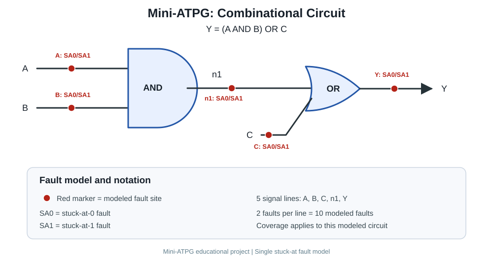

# Mini-ATPG: Automated Test Pattern Generation and Fault Coverage Analysis

## Overview

Mini-ATPG is a Python-based educational tool that demonstrates fundamental concepts in Automatic Test Pattern Generation (ATPG) and Design for Testability (DFT).

It evaluates combinational logic circuits, simulates single stuck-at faults, identifies input vectors that detect those faults, calculates modeled fault coverage, and exports reports as CSV files.

The project also supports configurable circuit definitions loaded from JSON, greedy test-set compaction, input solving for a desired output, fault diagnosis from observed circuit behavior, and recommendations for diagnostic test vectors.

## Objectives

- Model combinational logic circuits using Python.
- Simulate single stuck-at-0 (SA0) and stuck-at-1 (SA1) faults.
- Find input vectors that detect modeled faults.
- Calculate fault coverage for the modeled fault set.
- Reduce the number of test vectors using greedy compaction.
- Load circuit definitions from JSON files.
- Find input combinations that produce a desired output.
- Diagnose candidate faults from input and observed-output measurements.
- Recommend test vectors that distinguish between candidate faults.
- Export fault reports and compact test sets as CSV files.
- Validate functionality using automated unit tests.

## Circuit Under Test

The example circuit implements:

```text
n1 = A AND B
Y  = n1 OR C
```

Its Boolean expression is:

\[
Y = (A \land B) \lor C
\]

### Circuit Diagram



The example circuit has three binary inputs: `A`, `B`, and `C`. It therefore has \(2^3 = 8\) possible input vectors.

The configurable implementation loads circuit definitions from JSON and supports AND, OR, and NOT gates, subject to its validation and circuit-structure rules.

## Fault Model

The example circuit models single stuck-at faults on five signals:

- `A`
- `B`
- `C`
- `n1`
- `Y`

Each signal is evaluated under two fault conditions:

- Stuck-at-0 (SA0)
- Stuck-at-1 (SA1)

This produces 10 modeled single stuck-at faults.

A fault is detected when an input vector causes the faulty circuit's output to differ from the fault-free circuit's output.

Fault coverage is calculated against the modeled fault set. Results apply only to the supported fault model and circuit implementation.

## Features and Methodology

### 1. Fault Simulation

The tool evaluates the fault-free circuit and simulates injected stuck-at faults. It compares the faulty output against the expected fault-free output to determine whether each fault is detected.

### 2. Test Generation

The implementation enumerates possible input vectors and identifies vectors that detect modeled faults.

### 3. Fault Coverage Analysis

The tool records fault-detection results and calculates modeled fault coverage. Reports can be exported to CSV for further analysis.

### 4. Greedy Test-Set Compaction

The compaction algorithm repeatedly selects the input vector that detects the largest number of currently uncovered faults. It stops when all detectable modeled faults are covered or no remaining vector can detect an uncovered fault.

This is a greedy heuristic, not a guaranteed minimum-size solution.

For the example circuit, the observed compact test set contains four vectors and covers all 10 modeled faults.

### 5. Configurable Circuits

Circuit definitions can be loaded from JSON rather than being limited to the built-in example. The configurable implementation supports AND, OR, and NOT gates, subject to its input-validation and circuit-structure rules.

### 6. Input Solver

The input solver finds input combinations that produce a requested output for the built-in example circuit.

### 7. Fault Diagnosis

The diagnosis module uses supplied input observations and observed outputs to determine whether the fault-free circuit is consistent with the observations and, when appropriate, identify candidate modeled faults.

Diagnosis depends on the observations provided. Different faults can produce identical observable outputs, so the tool may not uniquely identify the physical cause.

### 8. Diagnostic Test Recommendation

The diagnostic recommender evaluates possible input vectors against candidate faults and recommends vectors whose predicted outputs distinguish between fault candidates.

Some fault pairs may be indistinguishable at the primary output under the supported test model. In such cases, the recommender may return no distinguishing vectors.

## Technologies Used

- Python 3
- Python standard library, including `itertools`, `csv`, `pathlib`, `argparse`, and `unittest`
- JSON for circuit configuration
- CSV for generated reports
- Visual Studio Code
- PowerShell

No third-party Python packages are required for the documented core workflows.

## Project Structure

```text
Mini_ATPG/
├── README.md
├── .gitignore
├── circuits/
│   └── example_circuit.json
├── docs/
│   └── circuit_diagram.svg
├── results/
│   ├── compact_test_set.csv
│   ├── configurable_compact_test_set.csv
│   ├── configurable_fault_report.csv
│   └── sample_fault_report.csv
├── src/
│   ├── circuit.py
│   ├── fault_simulator.py
│   ├── test_generator.py
│   ├── configurable_circuit.py
│   ├── configurable_fault_simulator.py
│   ├── configurable_test_generator.py
│   ├── input_solver.py
│   ├── fault_diagnosis.py
│   └── diagnostic_recommender.py
└── tests/
    ├── test_atpg.py
    ├── test_configurable_atpg.py
    ├── test_input_solver.py
    ├── test_fault_diagnosis.py
    ├── test_configurable_fault_diagnosis.py
    ├── test_diagnostic_recommender.py
    └── test_configurable_diagnostic_recommender.py
```

## Getting Started

### Requirements

- Python 3 installed
- A terminal such as PowerShell

No external Python packages are required.

Run the commands below from the project root.

### Run the built-in test generator

```powershell
python .\src\test_generator.py
```

### Run the configurable test generator

The configurable generator uses the example circuit JSON by default:

```powershell
python .\src\configurable_test_generator.py
```

To specify the circuit configuration and output paths:

```powershell
python .\src\configurable_test_generator.py --circuit .\circuits\example_circuit.json --csv .\results\configurable_fault_report.csv --compact-csv .\results\configurable_compact_test_set.csv
```

### Run the input solver

```powershell
python .\src\input_solver.py
```

### Run fault diagnosis

```powershell
python .\src\fault_diagnosis.py
```

### Run diagnostic test recommendation

```powershell
python .\src\diagnostic_recommender.py
```

### Run the automated tests

```powershell
python -m unittest discover -s tests -v
```

## Validation Results

The example circuit's established results are:

| Metric | Result |
|---|---:|
| Primary inputs | 3 |
| Possible input vectors | 8 |
| Modeled single stuck-at faults | 10 |
| Detected modeled faults | 10 |
| Modeled fault coverage | 100% |
| Vectors in the observed greedy compact set | 4 |

The project has also been extended with automated tests for input solving, fault diagnosis, and diagnostic test recommendation, including configurable circuits.

**Run the test command above to obtain the current test count and result.** Test counts can change as the implementation evolves, so this README does not hard-code a potentially outdated number.

These results apply to the implemented software model. They are not measurements from fabricated hardware and do not establish equivalence with industrial ATPG tools.

## Output Files

### `results/sample_fault_report.csv`

Fault report generated by the original implementation, recording modeled faults, detection status, and detecting vectors.

### `results/compact_test_set.csv`

Compact test set generated by the original implementation.

### `results/configurable_fault_report.csv`

Fault report generated by the configurable implementation.

### `results/configurable_compact_test_set.csv`

Compact test set generated by the configurable implementation, including coverage information for selected vectors.

The contents of the CSV files depend on the circuit configuration and the most recent program execution.

## Limitations

- Exhaustive input enumeration becomes impractical as the number of circuit inputs increases.
- The modeled fault set contains single stuck-at faults only.
- The configurable implementation supports AND, OR, and NOT gates.
- Fault diagnosis relies on observed input/output behavior and may not uniquely identify a fault.
- Diagnostic recommendations may be unable to distinguish faults with identical observable output behavior.
- Greedy compaction does not guarantee a globally minimum-size test set.
- Sequential circuits, scan chains, timing faults, and physical chip testing are not supported.
- The project has not been validated against fabricated hardware or benchmarked against commercial ATPG tools.

## Future Improvements

- Add more example circuits and gate types.
- Visualize circuit structure and fault propagation.
- Compare greedy compaction with an exact minimum set-cover solution.
- Improve reporting of undetectable and indistinguishable faults.
- Add more diagnostic test cases and benchmark circuits.
- Explore Verilog simulation and integration with free electronic design automation tools.

## Author

**Shabnam Nisha**

Electronics and Communication Engineering Student

## Disclaimer

Mini-ATPG is an educational implementation intended to demonstrate basic ATPG and DFT concepts. It is not a replacement for industrial ATPG software or physical silicon validation.
